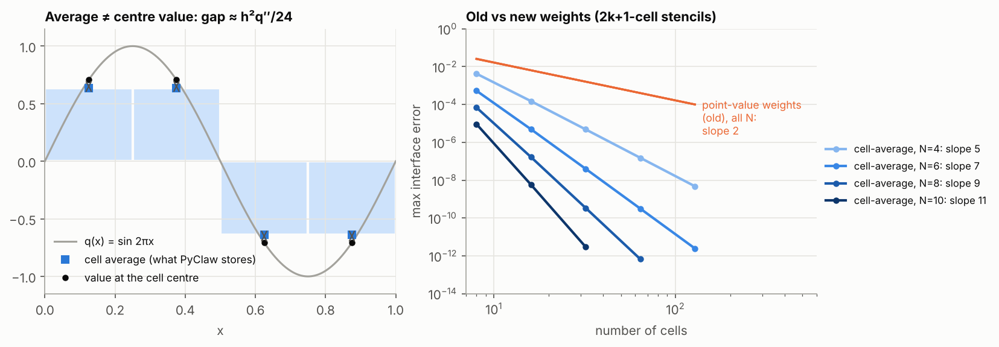
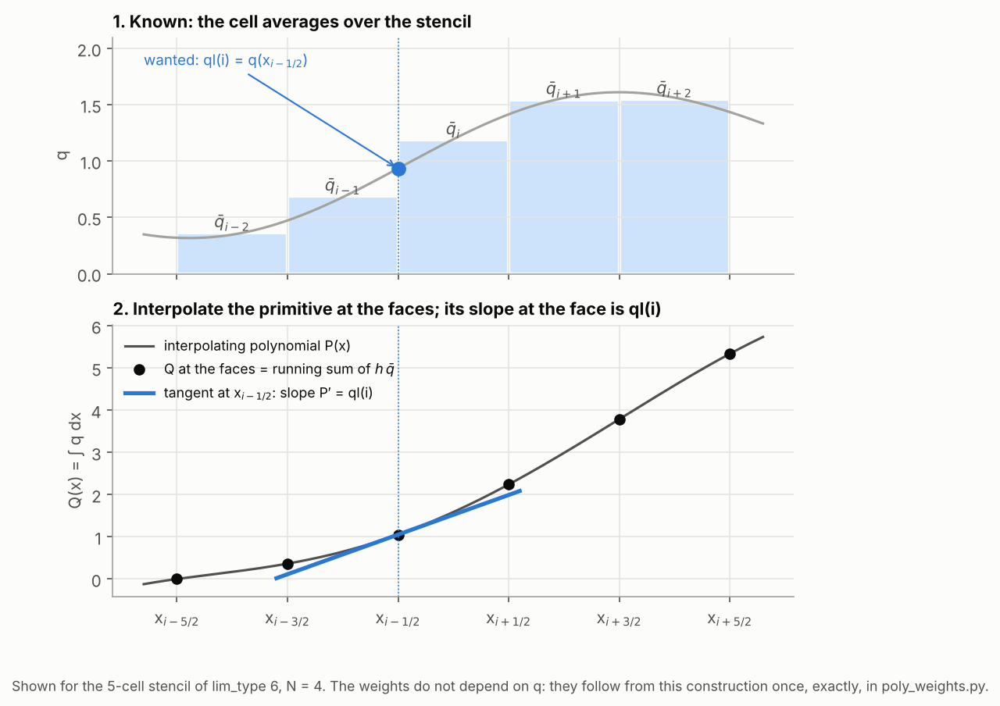
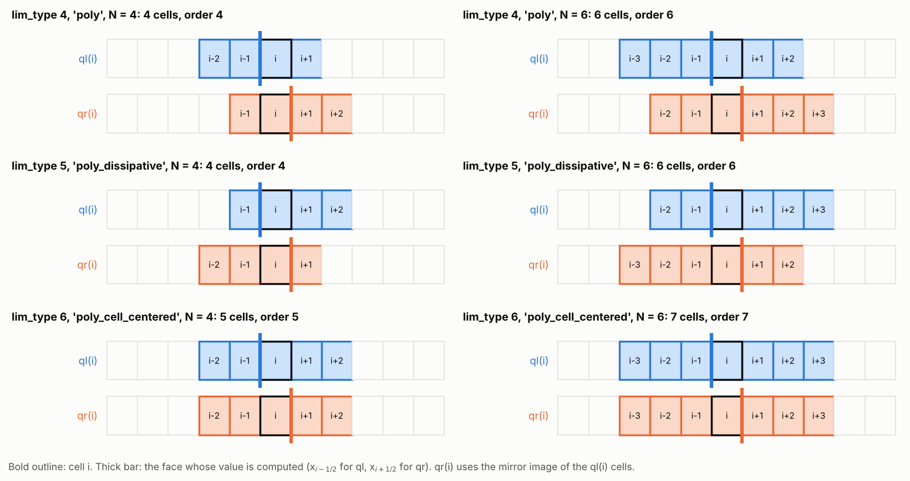
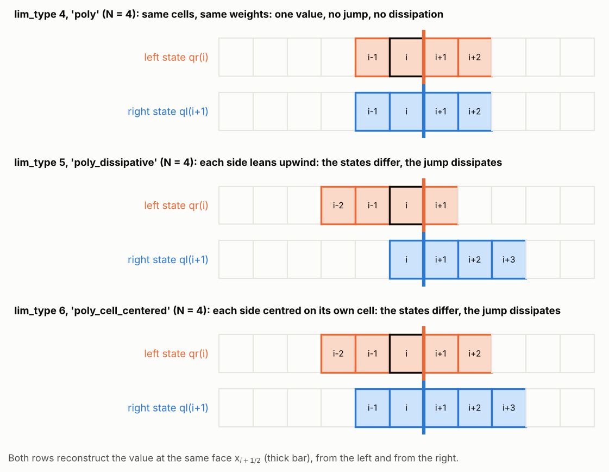
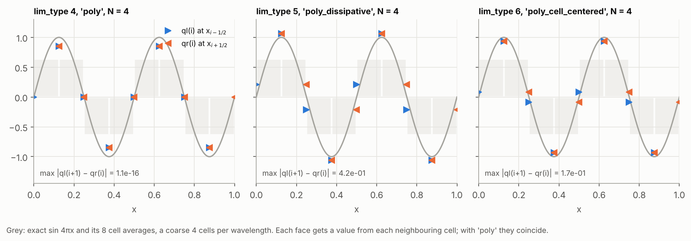
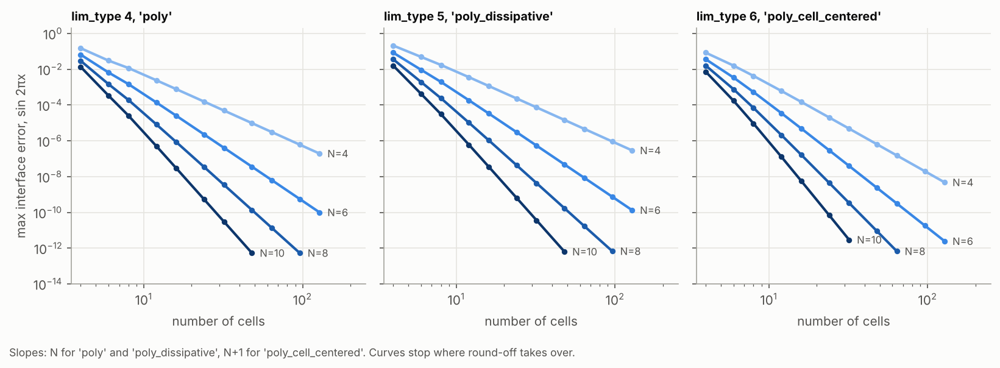
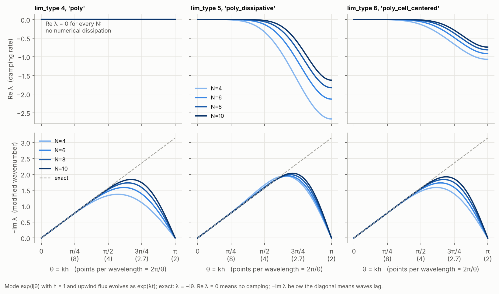

:group: pyclaw

.. _sharpclaw_poly:

=========================================
Polynomial reconstructions in SharpClaw
=========================================

.. note::

   These options are in PyClaw's development version (`clawpack/pyclaw#492 <https://github.com/clawpack/pyclaw/pull/492>`_) and are not yet part of a Clawpack release.

.. contents::
   :local:
   :depth: 1

Along with TVD and WENO, the SharpClaw solvers (see :ref:`sharpclaw_solvers`) offer three linear polynomial reconstructions, selected with ``solver.lim_type``.  They were written for electromagnetic wave problems, where an option that adds no numerical dissipation is valuable.  This page explains what they compute, which cells they use, how accurate they are, and how they damp and disperse waves.

.. list-table::
   :header-rows: 1
   :widths: 10 25 25 10 20

   * - ``lim_type``
     - name
     - cells per face value
     - formal order
     - numerical dissipation
   * - 4
     - ``'poly'``
     - N, centred on the face
     - N
     - none
   * - 5
     - ``'poly_dissipative'``
     - N, shifted one cell upwind
     - N
     - strongest
   * - 6
     - ``'poly_cell_centered'``
     - N+1, centred on the cell
     - N+1
     - moderate

N is ``solver.poly_order``, an even number in {4, 6, 8, 10}.

Using them
==========

::

    from clawpack import pyclaw, riemann

    solver = pyclaw.SharpClawSolver1D(riemann.acoustics_1D)
    solver.lim_type = 'poly'    # same as 4; or 'poly_dissipative' (5),
                                # or 'poly_cell_centered' (6)
    solver.poly_order = 6       # even: 4, 6, 8 or 10; default 4

``lim_type`` may be set to the integer or to the name; it is stored, and read back, as an integer.  Only the three polynomial reconstructions have names; the other values are integers (-1 Godunov, Python kernels only; 1 TVD; 2 WENO; 3 the original fifth-order WENO routine).

``poly_order`` and ``weno_order`` (for ``lim_type = 2``; odd, 5 to 17, default 5) are independent.  Setting either one does not change ``lim_type``, so each keeps its value when you switch between WENO and a polynomial reconstruction.

The solver checks these settings when it is set up:

* a ``poly_order`` outside {4, 6, 8, 10} with ``lim_type`` 4, 5 or 6, an invalid ``weno_order`` with ``lim_type = 2``, or a ``lim_type`` outside -1 to 6 raises ``ValueError``;
* ``lim_type = 0``, Godunov (-1) with Fortran kernels, or a polynomial reconstruction with Python kernels raises ``NotImplementedError``.

``num_ghost`` is set to N/2 + 1 automatically.

Limitations
-----------

* **No limiting.**  At discontinuities the reconstructions produce Gibbs oscillations; they are meant for smooth solutions.
* **Fortran kernels only**, applied component-wise (``char_decomp`` is ignored).
* **Dimensions.**  The 2D and 3D solvers apply the 1D reconstruction along each direction.  The reconstructions are tested in 1D and 2D.
* **Energy conservation** of ``'poly'`` (see `Dissipation and dispersion`_) holds for linear, constant-coefficient problems.  With variable coefficients (e.g. material interfaces stored in ``aux``) it is not guaranteed and should be checked for the problem at hand.
* **Time integration.**  The default time integrator, ``'SSP104'``, is fourth order, so for N > 4 the time error dominates unless the CFL number is reduced.

What a reconstruction computes
==============================

PyClaw is a finite-volume code: ``q[i]`` holds the **average** of the solution over cell :math:`i`,

.. math::

   \bar q_i = \frac{1}{h}\int_{x_{i-1/2}}^{x_{i+1/2}} q(x)\,dx .

At every step SharpClaw needs the solution **at the faces**.  For each cell the reconstruction returns two values: ``ql(i)``, the value at its left face :math:`x_{i-1/2}`, and ``qr(i)``, the value at its right face :math:`x_{i+1/2}`.  Face :math:`x_{i+1/2}` therefore receives two values, ``qr(i)`` from the left and ``ql(i+1)`` from the right, and the Riemann solver resolves the jump between them.  That jump is where the upwinding, and so the numerical dissipation, comes from.  Nothing computes values at cell centres.

All three reconstructions are linear combinations of nearby averages with fixed weights:

.. math::

   q^L_i = \sum_j w_j\,\bar q_{i+j}, \qquad q^R_i = \sum_j w_j\,\bar q_{i-j},

where :math:`q^L_i` is ``ql(i)`` and :math:`q^R_i` is ``qr(i)``.

Why the averages must be treated as averages
============================================

An average is not the value at the cell centre.  For smooth :math:`q`,

.. math::

   \bar q_i = q(x_i) + \frac{h^2}{24}\,q''(x_i) + O(h^4).

Weights that interpolate point values (Lagrange interpolation through the cell centres) inherit that :math:`O(h^2)` error, whatever the stencil width. The first version of the Fortran kernel did exactly this, and every N converged at second order.

   Left: what PyClaw stores (cell averages) differs from the values at the cell centres by about :math:`h^2 q''/24`.  Right: interface error for the :math:`N+1`-cell stencils of ``'poly_cell_centered'``.  Point-value weights (orange) converge at second order for every N; weights built from the averages (blue) converge at order N+1.

How the weights are built
=========================

The primitive function :math:`Q(x) = \int_{x_0}^{x} q\,dx` is known **exactly** at every face: it is a running sum of :math:`h\,\bar q`. Interpolate :math:`Q` at the faces of the stencil with a polynomial :math:`P`, and the face value is the slope :math:`P'` at that face.  The weights do not depend on :math:`q`, so this is done once, in exact rational arithmetic, by PyClaw's ``poly_weights.py`` (see `How the figures were made`_).

   The primitive-function construction.

Which cells each type uses
==========================

With :math:`k = N/2`, the cells used are

.. list-table::
   :header-rows: 1
   :widths: 22 20 20 38

   * - type
     - cells for ``ql(i)``
     - cells for ``qr(i)``
     - idea
   * - ``'poly'``
     - :math:`i-k \dots i+k-1`
     - :math:`i-k+1 \dots i+k`
     - N cells centred on the face
   * - ``'poly_dissipative'``
     - :math:`i-k+1 \dots i+k`
     - :math:`i-k \dots i+k-1`
     - the ``'poly'`` stencil shifted one cell upwind
   * - ``'poly_cell_centered'``
     - :math:`i-k \dots i+k`
     - :math:`i-k \dots i+k`
     - N+1 cells centred on cell :math:`i`

   Stencils for N = 4 and N = 6.

The difference that matters is what the two sides of one face see.  With ``'poly'``, ``qr(i)`` and ``ql(i+1)`` use the same cells with the same weights, so they are the same number: the Riemann solver sees no jump and adds no dissipation.  The other two types reconstruct each side from a different stencil, so the states differ by :math:`O(h^N)` (``'poly_dissipative'``) or :math:`O(h^{N+1})` (``'poly_cell_centered'``), and the jump is damped.

   The two states at one face.

Every type reaches :math:`k` cells from the cell being reconstructed, so SharpClaw sets ``num_ghost = N/2 + 1``.

Weights
-------

The weights for ``ql(i)`` are listed below; ``qr(i)`` uses the mirror image (:math:`w_j` applied to :math:`\bar q_{i-j}`).

**lim_type = 4,** ``'poly'``

.. list-table::
   :header-rows: 1
   :widths: 8 10 18 64

   * - N
     - order
     - cells for ``ql(i)``
     - weights
   * - 4
     - 4
     - i-2 … i+1
     - (-1, 7, 7, -1) / 12
   * - 6
     - 6
     - i-3 … i+2
     - (1, -8, 37, 37, -8, 1) / 60
   * - 8
     - 8
     - i-4 … i+3
     - (-3, 29, -139, 533, 533, -139, 29, -3) / 840
   * - 10
     - 10
     - i-5 … i+4
     - (2, -23, 127, -473, 1627, 1627, -473, 127, -23, 2) / 2520

**lim_type = 5,** ``'poly_dissipative'``

.. list-table::
   :header-rows: 1
   :widths: 8 10 18 64

   * - N
     - order
     - cells for ``ql(i)``
     - weights
   * - 4
     - 4
     - i-1 … i+2
     - (3, 13, -5, 1) / 12
   * - 6
     - 6
     - i-2 … i+3
     - (-2, 22, 57, -23, 7, -1) / 60
   * - 8
     - 8
     - i-3 … i+4
     - (5, -55, 365, 743, -307, 113, -27, 3) / 840
   * - 10
     - 10
     - i-4 … i+5
     - (-3, 37, -233, 1207, 2131, -893, 367, -113, 22, -2) / 2520

**lim_type = 6,** ``'poly_cell_centered'``

.. list-table::
   :header-rows: 1
   :widths: 8 10 18 64

   * - N
     - order
     - cells for ``ql(i)``
     - weights
   * - 4
     - 5
     - i-2 … i+2
     - (-3, 27, 47, -13, 2) / 60
   * - 6
     - 7
     - i-3 … i+3
     - (4, -38, 214, 319, -101, 25, -3) / 420
   * - 8
     - 9
     - i-4 … i+4
     - (-5, 55, -305, 1375, 1879, -641, 199, -41, 4) / 2520
   * - 10
     - 11
     - i-5 … i+5
     - (12, -153, 947, -4003, 15797, 20417, -7303, 2597, -703, 122, -10) / 27720

Two checks on these numbers: ``'poly'`` with N = 4 is the classical fourth-order face value (-1, 7, 7, -1)/12, and ``'poly_cell_centered'`` with N = 4 equals WENO5 with its ideal (linear) weights.

Accuracy
========

PyClaw's ``sine_reconstruction.py`` reconstructs :math:`\sin 2\pi x` from its exact cell averages on a periodic grid and compares the face values with the exact ones.  At a coarse 4 cells per wavelength the difference between the types is visible: all three are close to the curve, but only ``'poly'`` gives each face a single value.

   Face values of :math:`\sin 4\pi x` from 8 cells.

Errors fall at the formal order until they reach round-off:

   Convergence of the interface error.

Observed orders of the maximum interface error, from 16 and 32 cells:

.. list-table::
   :header-rows: 1
   :widths: 28 18 18 18 18

   * - type
     - N = 4
     - N = 6
     - N = 8
     - N = 10
   * - ``'poly'``
     - 3.98
     - 5.97
     - 7.95
     - 9.94
   * - ``'poly_dissipative'``
     - 3.98
     - 5.97
     - 7.95
     - 9.94
   * - ``'poly_cell_centered'``
     - 4.96
     - 6.94
     - 8.93
     - 10.92

These come from the reconstruction alone.  In the full solver the observed order is also limited by the time integrator (see `Limitations`_).

Dissipation and dispersion
==========================

For the model problem :math:`u_t + u_x = 0` with the upwind flux, the semi-discrete scheme evolves a Fourier mode :math:`e^{\mathrm{i} j\theta}` (:math:`\theta = \kappa h`, with :math:`\kappa` the wavenumber) as :math:`e^{\lambda t}`; the exact value is :math:`\lambda = -\mathrm{i}\theta/h`. :math:`\mathrm{Re}\,\lambda` is the damping rate and :math:`-\mathrm{Im}\,\lambda` the modified wavenumber (below the diagonal, waves travel too slowly).

   Damping rate and modified wavenumber.

The same data at a few resolutions, as phase-speed ratio :math:`-\mathrm{Im}\,\lambda/\theta` (1 is exact) / damping rate :math:`\mathrm{Re}\,\lambda` (with :math:`h = 1`):

.. list-table::
   :header-rows: 1
   :stub-columns: 1

   * - points per wavelength
     - ``'poly'`` N=4
     - ``'poly'`` N=8
     - ``'poly_dissipative'`` N=4
     - ``'poly_dissipative'`` N=8
     - ``'poly_cell_centered'`` N=4
     - ``'poly_cell_centered'`` N=8
   * - 16
     - 0.9992 / 0
     - 1.0000 / 0
     - 1.0011 / -0.000
     - 1.0000 / -0.000
     - 1.0000 / -0.000
     - 1.0000 / -0.000
   * - 8
     - 0.9882 / 0
     - 0.9998 / 0
     - 1.0140 / -0.008
     - 1.0002 / -0.000
     - 0.9985 / -0.003
     - 1.0000 / -0.000
   * - 6
     - 0.9648 / 0
     - 0.9983 / 0
     - 1.0337 / -0.042
     - 1.0013 / -0.002
     - 0.9924 / -0.017
     - 0.9996 / -0.001
   * - 4
     - 0.8488 / 0
     - 0.9701 / 0
     - 1.0610 / -0.333
     - 1.0065 / -0.057
     - 0.9337 / -0.133
     - 0.9863 / -0.025

(-0.000 is a small negative damping rate that rounds to zero at three decimals.)

What this means in practice:

* **'poly' does not damp anything.**  :math:`\mathrm{Re}\,\lambda = 0` for every wavenumber, so for linear, constant-coefficient problems the semi-discrete scheme conserves the discrete :math:`L^2` energy; only the time integrator dissipates (slightly).  The flip side is that unresolved modes, including grid-scale (:math:`\theta = \pi`) noise, are never damped. Waves lag (phase speed below 1).
* **'poly_dissipative' damps most**, and its waves run slightly fast (phase speed above 1).
* **'poly_cell_centered' damps less**, and its waves lag.  It has an exact relation to ``'poly'``: the average of its two face states is the ``'poly'`` face value with ``poly_order`` N+2.  In other words, ``'poly_cell_centered'`` with ``poly_order`` N is ``'poly'`` with ``poly_order`` N+2 plus an upwind correction proportional to the jump, which is why their dispersion curves coincide.

How the figures were made
=========================

The figures on this page are static images. They were drawn by ``make_figures.py``, which is kept, together with the two scripts it uses, on the `sharpclaw-poly-figures branch <https://github.com/sanromd/doc/tree/ee50b0d85d6bcd58c18dde8ff1fe8fa3434598ee>`_ of sanromd/doc (commit ``ee50b0d8``). Its README explains how to regenerate the figures byte for byte.

The weight tables and the observed-order table come from ``python poly_weights.py --table`` and ``python sine_reconstruction.py`` in PyClaw's ``development/poly_reconstruction/`` directory. There ``poly_weights.py`` also generates the Fortran weights (``src/pyclaw/sharpclaw/poly.f90``), and PyClaw's test suite checks that the compiled weights equal the exact ones. If the stencils change, the figures and tables on this page have to be regenerated.
